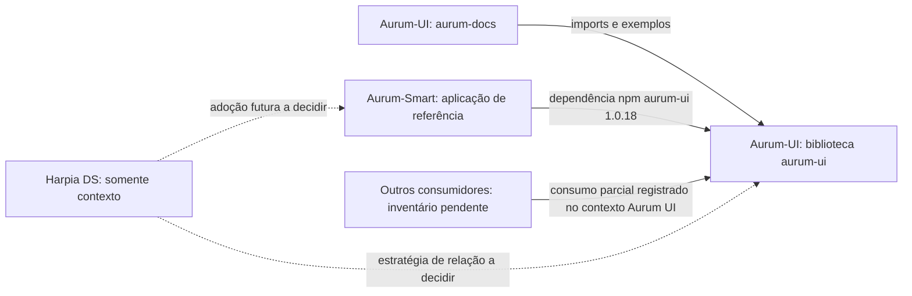
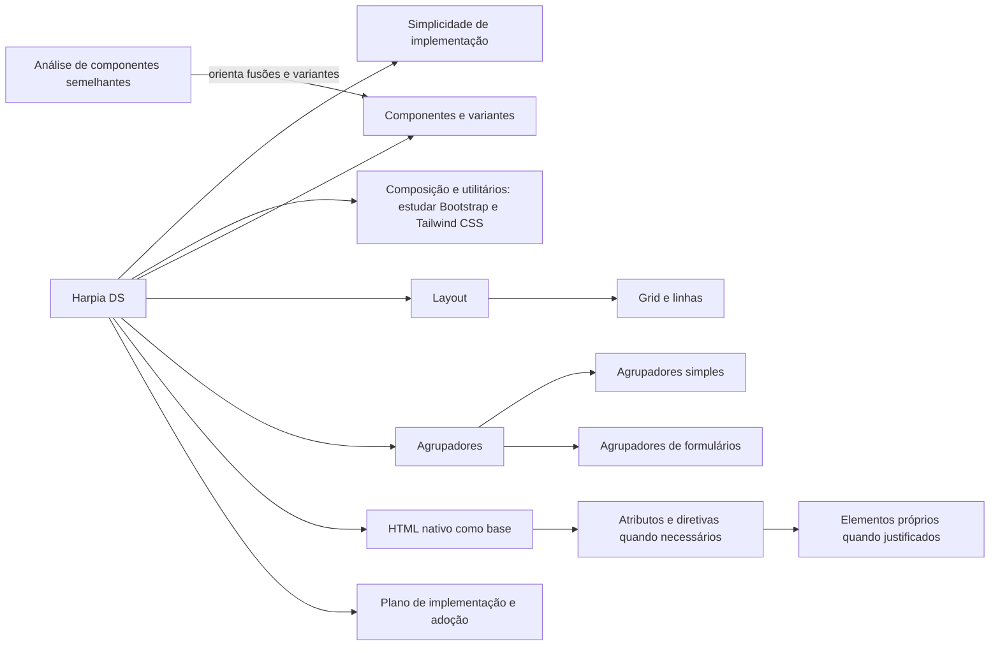

# Grafo de contexto

Linha contínua indica relação verificada nos arquivos locais. Linha tracejada indica possibilidade futura, ainda sem contrato ou implementação.

Evidências: `Aurum-UI/aurum-workspace/angular.json`, `Aurum-UI/docs/context/graph.md`, `Aurum-UI/aurum-workspace/projects/aurum-ui/package.json` e `Aurum-Smart/package.json`. Arestas futuras não autorizam mudanças nesses repositórios.

## Grafo de capacidades planejadas

As arestas abaixo representam requisitos informados pelo solicitante. Nenhum nó corresponde a implementação atual do Harpia DS.

